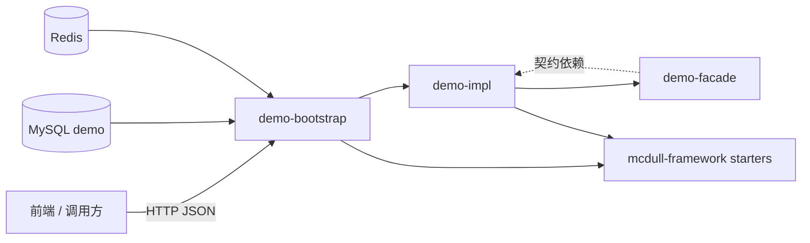

# mcdull-business-demo

McDull 业务层的可运行示例工程。它不是一个空壳：这里完整落了一个“演示任务（demo_task）”的 CRUD 能力，用来展示业务模块的标准拆分、四层调用、契约设计、统一返回、参数校验、缓存/锁以及 ArchUnit 架构守护。

## 1. 定位

一句话：**用最小业务场景演示 mcdull 的业务模块应该怎么写、怎么配、怎么验。**

它同时是三件事：

1. 新业务模块的脚手架参考：复制 `demo-facade` / `demo-impl` / `demo-bootstrap` 的结构即可起步。
2. 架构规范的活样例：`facade` 与 `provider` 分包，Controller / Service / Manager / Mapper 分层清晰。
3. 可独立运行的服务：初始化 SQL 后启动 `demo-bootstrap`，通过 Knife4j 或直接调用 REST 接口验证。

## 2. 架构总览



依赖方向必须保持单向：

```
demo-bootstrap  ──依赖──▶  demo-impl  ──依赖──▶  demo-facade
        │                    │                    │
        └────────────────────┴────────────────────┘
                             │
                             ▼
                 mcdull-framework / starters
```

禁止反向依赖：`demo-facade` 不得依赖 `demo-impl`，任何业务模块不得直接依赖其他模块的 `impl`。

### 2.1 三个子模块

| 子模块 | 职责 | 主要内容 |
|---|---|---|
| `demo-facade` | 对外契约 | DTO、VO、枚举、常量；只依赖 `mcdull-framework-base` 的标记接口与校验注解 |
| `demo-impl` | 业务实现 | Controller、Service、Manager、Mapper、Entity、BO、ArchUnit 测试 |
| `demo-bootstrap` | 启动与配置 | `DemoApplication`、`application.yml`、`application-prod.yml`，打成可执行 jar |

依赖放置原则：`demo-impl` 声明业务代码编译期直接使用的 API；`demo-bootstrap` 声明应用运行时装配的 Starter。判断标准很简单：**哪个模块直接 import 了该 Starter 的类或使用了它的注解，哪个模块就声明它**。因此不是所有 Starter 都要在两边重复声明。

| 依赖模块 | demo-impl | demo-bootstrap | 原因 |
|---|---|---|---|
| `mcdull-framework-api-web` | 是 | 否 | impl 用 `BasicController` / `IEnum` / `SystemEnvironment` / 字典枚举 / Web 工具 |
| `mcdull-framework-starter-web` | 否 | 是 | bootstrap 用 `@EnableWebCore`；starter 依赖 api-web |
| `mcdull-framework-core-mysql` | 是 | 否 | impl 用 `LogicCheckUtil` / `BaseMapper` / `Page` 等数据库基类与工具 |
| `mcdull-framework-starter-mysql` | 否 | 是 | bootstrap 用 `@EnableDynamicDataSource` / `@MapperScan`；starter 依赖 core-mysql |
| `mcdull-framework-api-redis` | 是 | 否 | impl 用 `@CacheExpire` / `@RedisLock` / `IRedissonCache` / `IRedisClient`，零依赖 API 模块 |
| `mcdull-framework-starter-redis` | 否 | 是 | bootstrap 用 `@EnableCache`；starter 依赖 api-redis |
| `mcdull-framework-starter-doc` | 是 | 否 | impl 用 `@Operation` / `@SchemaEnum`；bootstrap 不直接引用，由传递依赖提供 |
| `mcdull-framework-starter-oss` | 否 | 否 | 文件能力统一由 system 提供 |
| `mcdull-framework-starter-security` | 否 | 是 | 运行时鉴权过滤器，由 bootstrap 组装 |
| `mcdull-framework-starter-tag` | 否 | 是 | 自动配置 + 请求头生效，demo 代码未直接引用；放 impl 会把运行时能力绑进业务 jar |
| actuator / prometheus | 否 | 是 | 生产可观测端点，由 bootstrap 组装 |

同一 GAV 在两边声明不会导致 jar 重复进入最终产物，Maven 会去重；重复声明表达的是**两个模块各自有直接使用理由**。

关于“能被 impl 引用是不是就不该叫 Starter”：

- Starter 的本质是**依赖聚合 + 自动装配**，不是“业务代码不能引用它”。使用 `@Cacheable`、`@FeignClient`、`@RedisLock` 这类注解很正常。
- 但如果 Starter **自身的注解/基类**被业务代码大量直接引用，说明 API 与自动装配没有拆干净。更理想的结构是拆成 `*-api` / `*-core` 放注解、SPI、常量和轻量基类，`*-starter` 只放自动配置、切面、过滤器，并依赖 `*-api`。
- mcdull 已经有 `mcdull-framework-spi` 这种 API 模块思想；redis、web、feign 已拆出 `api-*` 模块，原 package 保持不变，切面、Filter、自动装配留在对应 starter。web 的 `EnumVO` 通过可注入的 `TextResolver` 解耦 Spring 容器，由 starter 的 `I18nConfig` 注入 i18n 实现；redis 的 `RedissonCache` / `RedisClient` 是运行时组件，不迁入 API，而是在 api-redis 中提供 `IRedissonCache` / `IRedisClient` 契约，业务代码注入接口。
- mysql 的可复用基类和工具带行为，按业界习惯命名为 `mcdull-framework-core-mysql`；自动配置、AOP 与数据源实现仍留在 `mcdull-framework-starter-mysql`。后续若把 mysql 能力上升为 db，artifact 将成对改名为 `core-db` / `starter-db`，Java package 届时同步迁移。

### 2.2 impl 内部四层

```
io.gitee.dqcer.mcdull.demo.provider
├── config          # DemoTaskEnumConfig / DemoTaskTextResolver，Entry 层基础设施适配
├── model
│   ├── bo          # DemoTaskBO        业务对象，仅在 impl 内部流转
│   └── entity      # DemoTaskEntity    持久化对象，对应 demo_task 表
└── web
    ├── controller  # DemoTaskController  HTTP 入口，只做参数/结果适配
    ├── service     # IDemoTaskService + impl  业务编排、事务、缓存边界
    ├── manager     # IDemoTaskManager + impl  查询条件组装、数据访问编排
    └── dao.mapper  # DemoTaskMapper    MyBatis-Plus BaseMapper
```

调用方向固定为：

```
Controller ──▶ Service ──▶ Manager ──▶ Mapper
                │            │
                └── BO ──────┘
```

Controller 不直接访问 Mapper，Manager 不向上访问 Controller，跨层调用由 ArchUnit 测试强制拦截。

## 3. 已实现的示例能力

以“演示任务”为载体，展示了以下能力：

| 能力 | 落点 | 说明 |
|---|---|---|
| 统一返回 | `Result<T>` | Controller 统一返回 `code/message/data/traceId` |
| 分页查询 | `PagedDTO` + `PageUtil` + `PagedVO` | 请求页大小/页码校验，响应带 total/totalPage |
| 参数校验 | `@Valid` + `@EnumsIntValid` | 枚举 code 非法时直接被 Bean Validation 拦截 |
| 契约枚举 | `DemoTaskStatusEnum` / `DemoTaskPriorityEnum` | 纯 POJO，不实现 `IEnum`，不依赖 starter-web |
| 文档枚举 | `@SchemaEnum` | Knife4j 自动列出枚举值 |
| 对象分层 | DTO / BO / Entity / VO | 每层只做自己职责范围内的转换 |
| 声明式缓存 | `@Cacheable` + `@CacheExpire` | 详情缓存 300 秒并带随机浮动，防雪崩 |
| 分布式锁 | `@RedisLock` | 创建/修改时用任务标识做锁 key |
| 逻辑删除 | `del_flag` + `@TableLogic` | 继承 `BaseEntity` 自动获得审计字段 |
| 架构守护 | `DemoArchitectureTest` | 分层、命名、角色归属、facade 隔离、编码红线 |

## 4. 快速开始

### 4.1 环境要求

| 组件 | 版本 |
|---|---|
| JDK | 17+ |
| Maven | 3.6+ |
| MySQL | 8.x |
| Redis | 5.0+ |

### 4.2 初始化数据库

执行模块自带的初始化脚本：

```bash
mysql -uroot -p < mcdull-business/mcdull-business-demo/sql/demo.sql
```

脚本会创建 `demo` 数据库、`demo_task` 表，并插入两条示例数据。

### 4.3 三环境配置

`application.yml` 只放通用配置，环境差异拆成三个 profile：

| Profile | 配置文件 | 数据库/Redis 来源 | tag 默认 |
|---|---|---|---|
| `local` | `application-local.yml` | 本机 localhost，开箱即跑 | 关闭 |
| `test` | `application-test.yml` | 环境变量注入，便于容器部署 | 开启，非严格 |
| `prod` | `application-prod.yml` | 部署平台/Secret 注入环境变量 | 关闭，灰度时显式开启 |

`application.yml` 中把 profile 设为**必填项**，不再提供默认值：

```yaml
spring:
  profiles:
    # 不设默认值：缺失时直接启动失败，避免生产误用本地配置
    active: ${SPRING_PROFILES_ACTIVE}
```

这行配置的含义是：

- `spring.profiles.active` 决定当前激活哪个 profile，从而额外加载 `application-{profile}.yml`。
- `${SPRING_PROFILES_ACTIVE}` 表示必须从 Spring Environment 中解析 `SPRING_PROFILES_ACTIVE`，没有默认值。
- 设置为 `local` 时加载 `application.yml + application-local.yml`；设置为 `test` 时加载 `application.yml + application-test.yml`；设置为 `prod` 时加载 `application.yml + application-prod.yml`。
- 同一个 profile 也会驱动 `logback-spring.xml` 中的 `<springProfile>` 分支和代码中的 `@Profile` Bean。

**为什么要去掉默认值？**

原先的 `${SPRING_PROFILES_ACTIVE:local}` 虽然方便本地开发，但生产如果漏配环境变量，会静默回退到 local，可能连到本地默认数据库/Redis。去掉默认值后，缺配置会在启动阶段直接失败，属于 fail-fast，比“跑起来但跑错环境”安全得多。

其他可选防御措施：

- 部署平台强制注入 `SPRING_PROFILES_ACTIVE`，并在 Helm/K8s 清单或发布流水线上做必填校验。
- 构建环境专用镜像时把 profile 写死为 `prod`，但这会牺牲“一次构建、多环境部署”。
- 自定义 `EnvironmentPostProcessor` 做更细的校验，但通常没有必要，占位符缺失已经足够早地阻断启动。

推荐组合：**应用内不设默认值 + 平台强制注入并校验**。

通过环境变量或启动参数切换：

```bash
# 本地
SPRING_PROFILES_ACTIVE=local mvn -pl mcdull-business/mcdull-business-demo/demo-bootstrap spring-boot:run
# 或
mvn -pl mcdull-business/mcdull-business-demo/demo-bootstrap spring-boot:run -Dspring-boot.run.profiles=local

# 测试环境
SPRING_PROFILES_ACTIVE=test java -jar demo-bootstrap-1.0.0.jar

# 生产环境
SPRING_PROFILES_ACTIVE=prod java -jar demo-bootstrap-1.0.0.jar
```

命令行参数 `--spring.profiles.active=prod` 的优先级高于环境变量。环境变量留空会导致启动失败，不要再依赖任何隐式回退。

#### 环境变量

| 变量 | 说明 | 示例 |
|---|---|---|
| `DEMO_SERVER_PORT` | 服务端口 | `6070` |
| `DEMO_DB_HOST` | 数据库主机名（端口 3306、库名 demo 已写死在 yml） | `db` |
| `DEMO_DB_USER` | 数据库账号 | `demo` |
| `DEMO_DB_PASSWORD` | 数据库密码 | `******` |
| `DEMO_REDIS_HOST` | Redis 地址 | `redis` |
| `DEMO_REDIS_PORT` | Redis 端口 | `6379` |
| `DEMO_REDIS_PASSWORD` | Redis 密码 | 空 |
| `DEMO_LOG_PATH` | 日志根目录，默认 `./logs` | `/data/logs/demo-bootstrap` |
| `DEMO_TAG_ENABLED` | 是否启用标签路由 | `true` |
| `ENV_TAG` | 实例标签，空值表示公共基准实例 | `gray-demo` |
| `NACOS_ADDR` | Nacos 地址，默认 `mcdull.io:8848` | `nacos.prod:8848` |
| `NACOS_USER` / `NACOS_PWD` | Nacos 账号密码 | `nacos` / `******` |
| `NACOS_NAMESPACE` | 命名空间，默认 `public` | `prod` |

#### 变量的注入方式

`${DEMO_DB_HOST}` 这类占位符会从 Spring `Environment` 的各类 PropertySource 中解析，常见方式如下：

| 方式 | 示例 | 适用场景 | 说明 |
|---|---|---|---|
| 操作系统环境变量 | `DEMO_DB_HOST=db java -jar ...` | **test / prod 推荐** | 镜像不带值，平台可审计、可重新注入 |
| JVM 系统属性 | `java -DDEMO_DB_HOST=db -jar ...` | 临时排障 | 密码会出现在进程参数中，生产不推荐 |
| 命令行参数 | `java -jar ... --DEMO_DB_HOST=db` | 临时覆盖 | 优先级最高，同样不要传密码 |
| `SPRING_APPLICATION_JSON` | `SPRING_APPLICATION_JSON='{"DEMO_DB_HOST":"db"}'` | 容器平台批量注入 | 一个变量传多值，注意转义 |
| 外部配置文件 | `--spring.config.additional-location=file:/etc/demo/` | 证书、复杂配置 | 配置挂载到容器，仍不进镜像 |
| profile yml 直写 | `application-local.yml` | 仅本地 | 生产禁止把凭据写进 yml |
| 服务注册中心 | Nacos | 全环境默认启用 | 仅用于服务注册与发现，业务配置通过环境变量或本地 yml 注入 |

简化后的优先级：命令行参数 > `SPRING_APPLICATION_JSON` > JVM 系统属性 > 操作系统环境变量 > 外部配置文件 > jar 内 yml。

本地 IDE 注入示例（IntelliJ IDEA）：

1. 打开 `Run/Debug Configurations` → `+` → `Spring Boot`
2. `Main class` 选择 `io.gitee.dqcer.mcdull.demo.DemoApplication`
3. 必须设置 profile：`Active profiles` 填 `local`，或在环境变量中写 `SPRING_PROFILES_ACTIVE=local`；二者设置其一即可，都不设置会启动失败
4. 在 `Environment variables` 中按表格逐行添加，或在旧版单行输入框中粘贴以下内容（Windows 用 `;` 分隔，macOS/Linux 用 `:` 分隔）：

```text
SPRING_PROFILES_ACTIVE=local;DEMO_DB_HOST=mcdull.io;DEMO_DB_USER=root;DEMO_DB_PASSWORD=123456;DEMO_REDIS_HOST=mcdull.io
```

`DEMO_DB_HOST` / `DEMO_DB_USER` / `DEMO_DB_PASSWORD` 无默认值，必须显式提供；即使连本机 MySQL，也要写 `DEMO_DB_HOST=localhost`，否则启动失败。

本地命令行临时覆盖示例（PowerShell）：

```powershell
$env:DEMO_DB_HOST = "localhost"
$env:DEMO_DB_USER = "root"
$env:DEMO_DB_PASSWORD = "123456"
$env:SPRING_PROFILES_ACTIVE = "local"
java -jar demo-bootstrap-1.0.0.jar
```

Kubernetes 生产注入示例：

```yaml
env:
  - name: DEMO_DB_HOST
    value: "mysql.prod"
  - name: DEMO_DB_PASSWORD
    valueFrom:
      secretKeyRef:
        name: demo-secret
        key: db-password
```

推荐做法：

- **local**：直接使用 `application-local.yml` 的默认值；需要临时覆盖时用 IDE Run Configuration 或 PowerShell 环境变量。
- **test / prod**：由部署平台注入环境变量；普通配置用 ConfigMap / `env_file`，密码用 Secret，避免命令行参数和 `-D` 传敏感值。
- **大量模板化配置或证书**：使用外部挂载配置目录，或通过 Nacos Data ID 管理。

这样做的原因：

- 环境变量由部署平台或 Secret 管理，镜像本身不携带具体环境凭据。
- Nacos 全环境默认启用，仅作为服务注册中心：服务注册与发现通过 `NACOS_ADDR` / `NACOS_NAMESPACE` 接入；业务配置通过环境变量或本地 `application-*.yml` 注入，无需在 Nacos 中创建共享 Data ID。
- 开启 Actuator 的 `health/info/prometheus` 端点，并启用优雅停机。
- 灰度 tag 默认关闭；开启后 `strict=true`，不允许流量回流到基准实例。

#### 日志配置

`demo-bootstrap/src/main/resources/logback-spring.xml` 提供按 profile 区分的日志策略：

| Profile | 输出 |
|---|---|
| `default` / `local` | 只输出控制台，避免本地产生日志目录 |
| `test` / `prod` | 控制台 + 全量滚动日志 `app.log` + 独立 `error.log` |

滚动策略按日期和大小切分：单文件 50MB、保留 30 天、总量上限 5GB。日志格式包含 `%X{traceId}`，与 `HttpTraceLogFilter` 写入 MDC 的链路 ID 打通。

日志根目录默认是 `./logs`，通过 `DEMO_LOG_PATH` 覆盖：

```bash
DEMO_LOG_PATH=/data/logs/demo-bootstrap java -jar demo-bootstrap-1.0.0.jar
```

容器内建议把该目录挂到持久卷，或改为 stdout 采集。`application-local.yml` / `application-test.yml` / `application-prod.yml` 中的 `logging.level` 仍可继续用于细粒度调整日志级别。

**本地是否需要 tag？**

- 单机 demo 直连本机 MySQL/Redis，没有 Nacos 注册、网关和 Feign 下游调用，tag 不产生任何路由价值，因此 `local` 默认 `mcdull.tag.enabled: false`。
- 如果多人共用一套开发服务联调，本地就需要 tag：引入 Nacos 后把 `local` 改为 `enabled: true`，并配置实例元数据，例如：

```yaml
spring:
  cloud:
    nacos:
      discovery:
        metadata:
          env-tag: ${ENV_TAG:${user.name}}
```

此时请求头带 `X-Env-Tag: 用户名` 会命中本地实例；不带标签或传 `default` 则走公共基准实例。


### 4.4 构建与启动

在仓库根目录执行：

```bash
mvn clean install -DskipTests
```

启动方式与 profile 切换见 4.3；默认使用 `local`。启动后访问：

- Knife4j 文档： <http://localhost:6070/doc.html>
- OpenAPI JSON： <http://localhost:6070/v3/api-docs>

